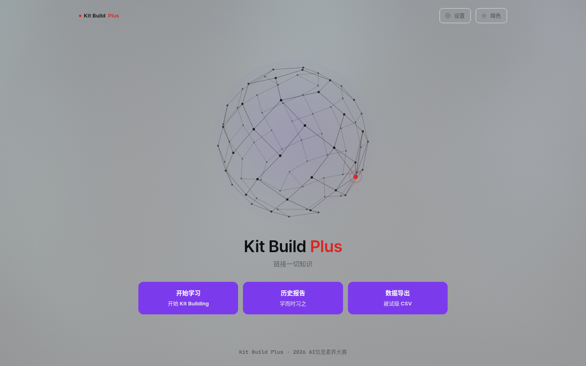
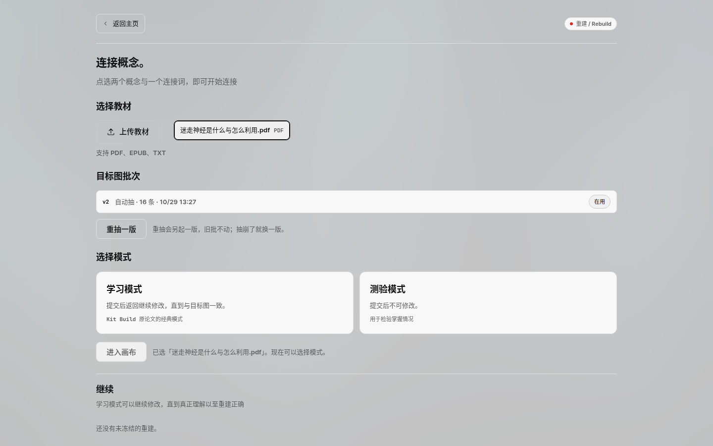
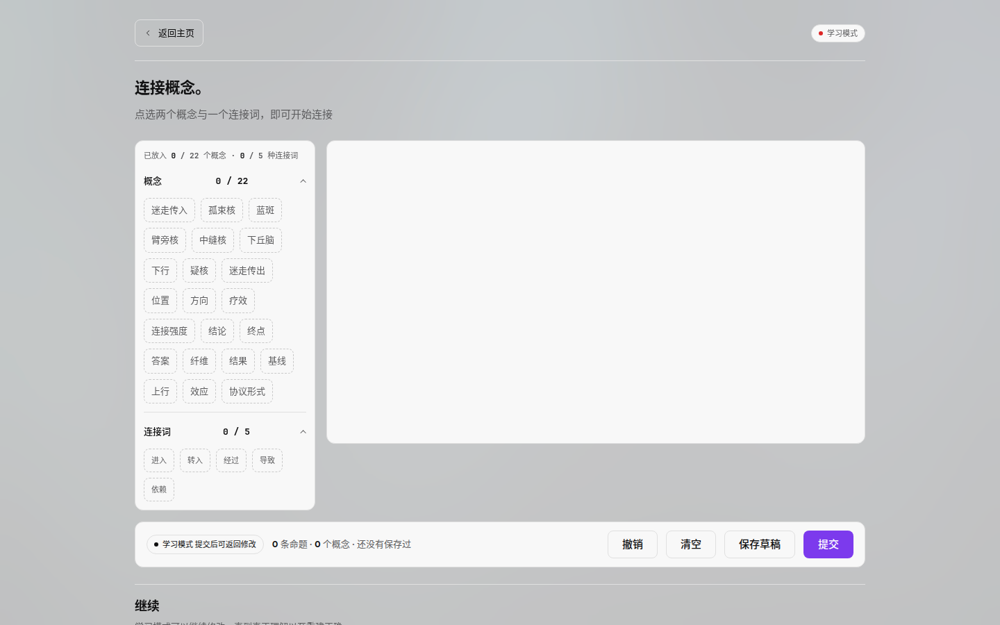
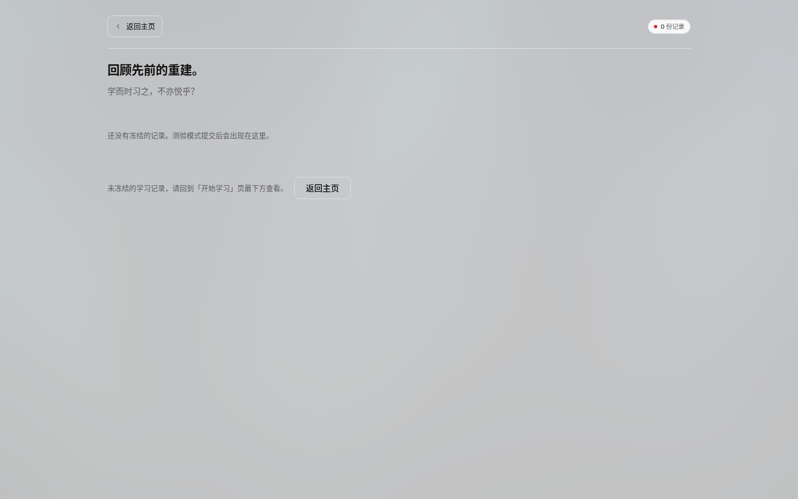

<!-- @zone user -->

# Kit-Build-Plus 链接一切知识

把 Kit-Build 里**教师做的两部分工作交给 LLM**：从教材里抽出专家概念图（goal map），再把图拆成一堆概念卡与连接词卡。学生只能用发给他的这些零件把图重新连出来，系统逐条比对命题，当场告诉他缺哪条、多哪条、方向反了哪条。

零件是封闭的，所以比对不需要图匹配，就是 O(E) 查表，快且可解释。

## 为什么值得做

Kit-Build 的教学效果有二十年实证支撑，但它一直卡在成本上：每份教材都要教师手工画目标图、手工拆零件，一节课要备半天。本项目把这两步换成 LLM，人只在中间审一次。

代价是目标图可能抽错。所以流程里保留了**人工审核**这道闸，并且有抽崩信号（概念过长、连接词越界、证据未在原文命中）主动报警。

## 界面

首页与手机版：



选教材、看目标图批次、选模式：



重建画布：左边是发给学生的零件，右边是画布，底部是实时命题计数：



历史报告与数据导出：



<!-- /@zone user -->
<!-- @zone code -->

## 跑起来

需要 Python 3.12。前端**已经构建好**放在 `web/dist`，跑服务不需要 Node。

```bash
git clone <仓库地址> && cd Kit-Build-Plus
python -m venv .venv && . .venv/bin/activate
pip install -r requirements.txt
python start.py --open
```

会自动打开 http://127.0.0.1:8848/ 。换端口用 `--port N` 或 `KBP_PORT`。

仓库自带一份示例教材（`data/materials/`）和它已经抽好的目标图（`data/kb.seed.sqlite3`），**不配任何 key 也能走完整条流程**：选教材 → 进画布 → 连图 → 提交 → 看报告。

第一次启动会把种子库和示例教材复制到 `tmp/`，之后只动 `tmp/` 那一份，`data/` 保持干净。删掉 `tmp/` 就回到初始状态。

要用 LLM 抽新教材的目标图，才需要配置：

```bash
cp .env.example .env    # 填 KBP_EXTRACT_* 与 KBP_API_KEY
```

扫描件没有文本层时才需要 MinerU OCR，`.env` 里填 `MINERU_TOKEN`。有文本层的 PDF 直接本地解析。

## 一次完整流程

1. **选教材**——自带的示例教材，或上传 PDF / EPUB / TXT
2. **抽目标图**——LLM 从原文抽三元组，人工在审核页增删改，确认后自动裁 kit
3. **重建**——学习模式可反复改直到与目标图一致；测验模式提交即锁，用来测掌握程度
4. **比对**——命题级查表，四类错误：方向反了、越界（用了范围外概念）、多连、漏连
5. **报告**——六板块报告，含修正前后对照；历史页可按被试导出 CSV

## 目录

```
kbp/            后端，一个功能一个子包
kbp/contracts/  契约层：跨功能只经这里
kbp/api/        FastAPI 路由层
web/            前端工程（React + TS + Vite + ReactFlow）
web/dist/       构建产物，随仓库提供
ui-share/       前端组件共享层
tests/          测试，按功能分子目录
data/           种子库与示例教材
docs/           SPEC、题录、截图
start.py        一键启动：一个端口同时给页面和 /api
```

## 架构上的三条硬约束

- `kbp/{feature}/` 之间不互相 import，跨功能交互只走 `kbp/contracts/`
- 一个契约域一个文件，字段注释写明含义、单位、可空性、枚举取值
- 出边界的格式转换由提供方做，调用点不包 converter

这样每个功能都能单独替换：换抽取模型只动 `extract`，换评分口径只动 `score`，接口由契约钉住。

## 测试

```bash
python -m pytest -q
python -m flake8 kbp tests start.py
```

推送和 PR 会自动跑一遍，并额外起服务探活首页，见 `.github/workflows/ci.yml`。

真实调用 MinerU 的端到端冒烟另有脚本，不属 pytest，手动跑：

```bash
set -a; . .env; set +a
PYTHONPATH=. .venv/bin/python tests/ingest/e2e_mineru.py
```

## 评分口径

图上的一条边就是一条命题 `(概念A, 连接词, 概念B)`。kit 封闭意味着学生提交的每条命题要么在目标图里、要么不在，所以评分是查表不是图编辑距离。

四类错误的判定顺序固定为「最具体 → 最泛化」：`reversed` → `leaving` → `excessive` → `lacking`。同一条错写可能既能读成「方向反了」又能读成「目标里没有」，固定顺序保证判定唯一。

## 论文与版权

Kit-Build 的原始论文与其中文译本**不随本仓库分发**。所有引用过的文献按 DOI 列在 `docs/research/文献清单.md`，同时提供 `references.bib` 与 `references.ris`，可直接导入 Zotero / EndNote 后按 DOI 自取原文。读法见 `docs/research/阅读顺序.md`。

## 许可

MIT，见 `LICENSE`。

## 已知限制

- 目标图质量取决于教材文本层。扫描件必须走 OCR，且 OCR 结果会带识别噪声
- 单机自用，没有多用户与鉴权，端口只绑 127.0.0.1
- 学习模式可反复修改，分数会收敛到满分，因此它只作过程量，不作结果变量

<!-- /@zone code -->
