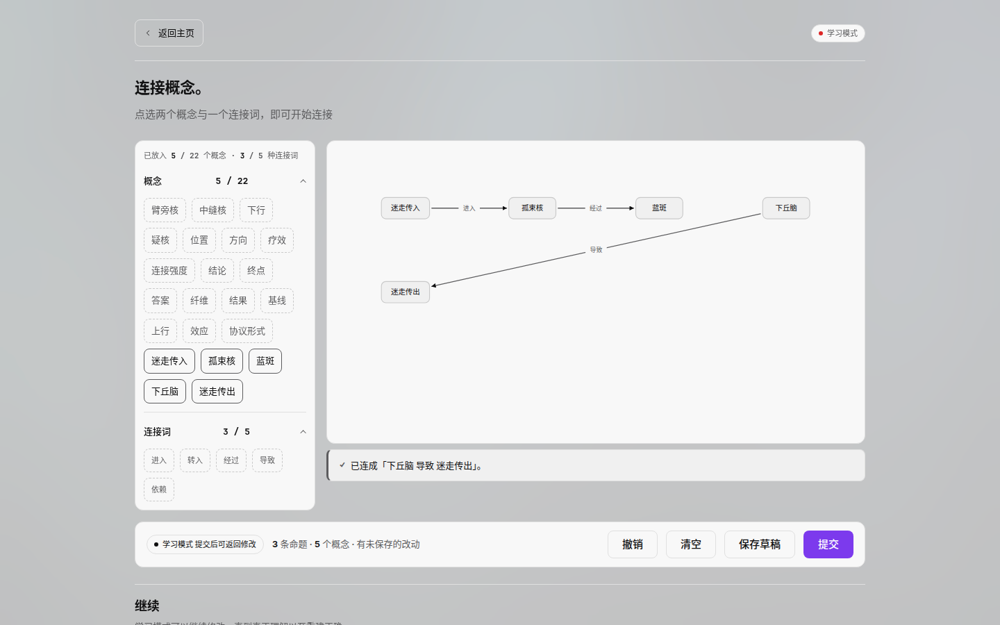
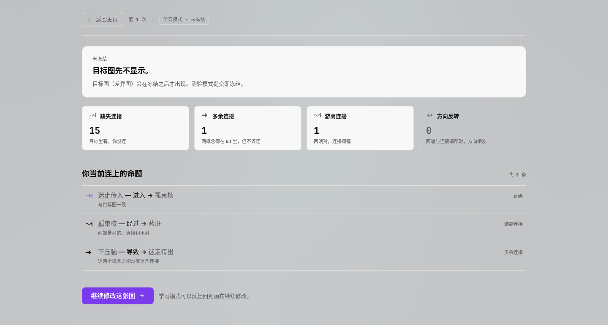
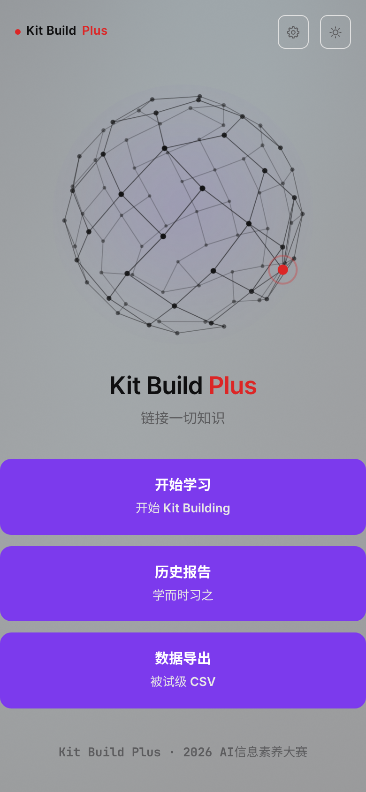

<!-- @zone user -->

<div align="center">
  

# Kit-Build-Plus

**简体中文**

  
  
  
  
  
  <br>
  <a href="https://github.com/kbplus-anoa/Kit-Build-Plus/actions/workflows/ci.yml"></a>

</div>

<div align="center">

> 把 Kit-Build 里教师的两步活交给 LLM：先从教材抽出专家概念图，再把图拆成一堆概念卡与连接词卡。
> 学生只能用发给他的这些零件把图连回去，系统逐条比对命题，当堂告诉他缺哪条、多哪条、方向反了哪条。
>
> *The teacher's job, delegated to a model: pull the expert concept map out of a textbook, cut it
> into concept cards and linking words, then let the student rebuild it. Scoring walks the
> propositions one by one. The kit is sealed, so scoring is an O(E) lookup, not graph edit
> distance — fast, and every number it reports can be pointed at a specific edge.*
>
> 不需要 API Key 就能跑完整条流程：仓库自带一份教材和它已经抽好的目标图。

</div>

## 亮点

- **教师的两步成本降到一次审核**——Kit-Build 的效果有二十年实证支撑，推广一直卡在备课成本上：每份教材都要手画目标图、手拆零件，一节课备半天。本项目把这两步换成抽取模型，人只在审核页动一次鼠标。审核前的候选、审核后的冻结图、冻结算出的零件包三层分开存，任何一层改错都能单独重来。

- **零件封闭，所以比对是查表**——发给学生的概念与连接词是有限集合。学生提交的每条命题要么在目标图里、要么不在，评分因此是 O(E) 查表而不是图编辑距离；每条判定都能落到具体一条边上，报告里点得出来。

- **四类错误，判定顺序固定**——缺连、多连、连接词用错、方向反了，四类分开计数。顺序刻意排成「最具体 → 最泛化」，同一条错写既能读成"多余"也能读成"方向反了"时，判定唯一。

- **学习模式与测验模式分工明确**——学习模式提交后可回去继续改，一直改到跟目标图一致，分数必然收敛到满分，所以它只出过程量（循环次数、修订条数、四类错误分布），不作结果变量。测验模式提交即冻结，用来测掌握程度，目标图在冻结之前不下发到前端。

- **目标图带版本与指纹**——重抽另起一版，旧版原地不动，切回旧版不重算。每版带内容指纹，比对与报告都能指认自己用的是哪一版。

- **抽崩会自己报警**——抽取结果带四条体检信号：概念过长、连接词越界、证据未在原文逐字命中、候选过少。命中就摆在审核页上，而不是让学生拿到一张已经烂掉的目标图。

- **教材来源三条腿**——PDF 有文本层就直接本地解析；扫描件走 MinerU OCR；EPUB / TXT 直接读。走了哪条路记在教材行上，报告里带得出来。

- **单机自用，不往外发包**——默认只绑 `127.0.0.1`。没有账号体系，也没有遥测；跑起来之后所有数据在 `tmp/` 一个目录里，删掉即回到初始状态。

## 你会看到什么

**首页**：一张自己会动的知识网络，三个入口。


**选教材**：挑一份教材，看它的目标图批次，选学习或测验模式。


**重建画布**：左边是发给学生的零件，右边是画布，底部实时报命题数与概念数。



**评分报告**：四类错误分开计数，逐条列出你连了什么、判定是什么、为什么。



**手机版**：版式重排，不是等比缩小。



## 安装

需要 Python 3.12。前端**已经构建好**放在 `web/dist`，跑服务不需要 Node。

```bash
git clone <仓库地址> && cd Kit-Build-Plus
python -m venv .venv && . .venv/bin/activate
pip install -r requirements.txt
python start.py --open
```

它会打开 http://127.0.0.1:8848/ 。换端口用 `--port N` 或环境变量 `KBP_PORT`。

第一次启动把种子库和示例教材复制到 `tmp/`，之后只动 `tmp/` 那一份，`data/` 保持干净。

要自己从 PDF 抽新教材的目标图，才需要配置模型接口：

```bash
cp .env.example .env    # 填 KBP_EXTRACT_ENABLED / KBP_EXTRACT_BASE_URL / KBP_EXTRACT_MODEL / KBP_API_KEY
```

扫描件没有文本层时才需要 MinerU OCR，`.env` 里填 `MINERU_TOKEN`。有文本层的 PDF 本地解析，不联网。

## 使用说明

1. **选教材**——自带的示例教材，或上传 PDF / EPUB / TXT
2. **抽目标图**——模型从原文抽三元组，在审核页增删改，确认后冻结并自动裁出零件包
3. **重建**——拖概念卡、选连接词连边；学习模式可反复改，测验模式提交即锁
4. **比对**——命题级查表，出四类错误计数与逐条判定
5. **报告**——六板块报告含修正前后对照；历史页可按被试导出 CSV

学习模式下提交后仍可改图，历史页里能看到每次提交的版本；测验模式提交后这张图就冻结了。

## 评分怎么算

图上的一条边就是一条命题 `(概念A, 连接词, 概念B)`。kit 封闭意味着学生提交的每条命题要么在目标图里、要么不在，于是：

```
正确 = 提交命题 ∩ 目标命题
```

剩下的一分为四，判定顺序固定为 `reversed` → `leaving` → `excessive` → `lacking`：

| 判定 | 含义 |
| --- | --- |
| `reversed` | 两端对、连接词对，方向相反 |
| `leaving` | 两端都在 kit 里，但用了范围外的连接词 |
| `excessive` | 两端都在 kit 里，目标图里没有这条连接 |
| `lacking` | 目标图里有，学生没连 |

为什么固定顺序：同一条错写可能既是"目标里没有"，也是"方向反了"。先判最具体的（方向），再判次具体的（连接词），最后才判最泛化的（多余）。顺序一变，同一张图的四类计数就会变。

分数按正确命题占比折算成 0–100。全对满分，空卷零分，四类错误互斥且不影响已经算对的命题。

## 实现结构

```
kbp/            后端，一个功能一个子包
  contracts/    契约层：跨功能只经这里
  api/          FastAPI 路由层与页面流的编排
  ingest/       教材入库：PDF 文本层 / MinerU OCR / EPUB / TXT
  extract/      从原文抽三元组，含模型客户端与抽崩信号
  quality/      抽取体检（S1–S4）
  kit/          目标图冻结、版本化、裁零件包
  rebuild/      学生图草稿、暂存、提交
  score/        命题级查表与四类错误
  export/       报告与 CSV 导出
web/            前端工程（React + TS + Vite + ReactFlow）
web/dist/       构建产物，随仓库提供
ui-share/       前端组件共享层
tests/          测试，按功能分子目录
data/           种子库与示例教材
start.py        一键启动：一个端口同时给页面和 /api
```

三条硬约束：

- `kbp/{feature}/` 之间不互相 import，跨功能交互只走 `kbp/contracts/`
- 一个契约域一个文件，字段注释写明含义、单位、可空性、枚举取值
- 出边界的格式转换由提供方做，调用点不包 converter

于是换抽取模型只动 `extract`，换评分口径只动 `score`，两边之间由契约钉住。

## 三个实现决定

**为什么是查表不是图匹配。** kit 封闭这条产品约束，直接决定了算法形态。如果允许学生自由加概念，就必须算图编辑距离或者做最优匹配，结果不可解释、也不可当堂反馈。锁死零件之后，一条命题的判定退化成一次集合查询，代价与边数同阶，而且说得出"你错在这一条"。

**为什么学习模式的分不作结果变量。** 学习模式的契约就是"改到与目标图一致"，收敛值必然是满分。把它当结果算，天花板效应会把任何教学干预的效应量压成零。所以学习模式只产出过程量，结果只从测验模式取。

**为什么冻结前不下发目标图。** 学习模式的目标图在提交冻结之前不能出现在前端包里，否则学生直接照抄。后端在组装零件包时就把目标图整块剥掉，只发概念标签、连接词与位置，前端即使被打开控制台也拿不到答案。

## 验收情况

下列命令都在公开克隆里原样跑过，输出非空：

| 命令 | 结果 |
| --- | --- |
| `python -m pytest -q` | 全绿 |
| `python -m flake8 kbp tests start.py` | 无输出 |
| `python start.py --port 8931` + `curl -o /dev/null -w '%{http_code}' /` | `200` |
| `curl /api/materials` | 返回示例教材一条 |
| `git clone` 到空目录后重跑上面四条 | 同上 |

仓库里另有一个真实调用 MinerU 的端到端冒烟脚本，不属 pytest（会花配额），需手工跑：

```bash
set -a; . .env; set +a
PYTHONPATH=. .venv/bin/python tests/ingest/e2e_mineru.py
```

推送与 PR 会自动跑一遍测试并额外起服务探活首页，见 `.github/workflows/ci.yml`。

## 已知边界

- **目标图质量受教材文本层限制**。扫描件必须走 OCR，OCR 的识别噪声会直接进候选三元组；这时审核页上的体检信号是主要防线。
- **没有多用户与鉴权**。端口只绑 `127.0.0.1`，设计前提是单机自用；要给一个班并发用，得先加会话隔离与提交队列。
- **连接词表是封闭的**，一个学科一份。跨学科教材需要各自的词表，词表版本变了旧目标图就不算数（契约里钉死了这条）。
- **评分只认命题级对错**，不评图的整体结构质量。同一组命题换一种画法，得分相同。
- **报告不写结论性评价**。它只描述状态，是否达成教学目标由人判断。

## 开发

```bash
python -m pytest -q                    # 测试
python -m flake8 kbp tests start.py    # 风格
cd web && npm install && npm run build # 重建前端（改了 web/ 才需要）
```

约定与目录纪律写在 `AGENTS.md`，需求与设计决策在 `SPEC.md`，统计与导出字段口径在 `STAT_PLAN.md`、`CSV_PLAN.md`。

CI 徽章已经指向本仓库的 workflow；Fork 之后把 badge 地址里的 `kbplus-anoa` 换成你自己的用户名即可。

## 论文与版权

Kit-Build 的原始论文与其中文译本**不随本仓库分发**。所有引用过的文献按 DOI 列在 `docs/research/文献清单.md`，同时提供 `references.bib` 与 `references.ris`，可直接导入 Zotero / EndNote 后按 DOI 自取原文。读法见 `docs/research/阅读顺序.md`。

## 许可

MIT，见 `LICENSE`。

<!-- /@zone user -->
